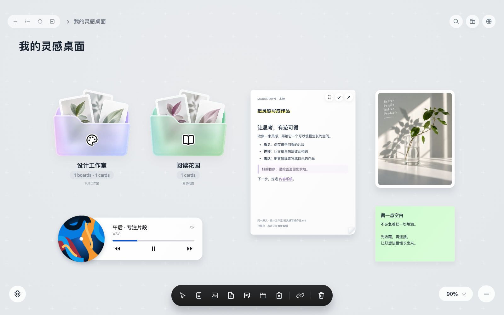
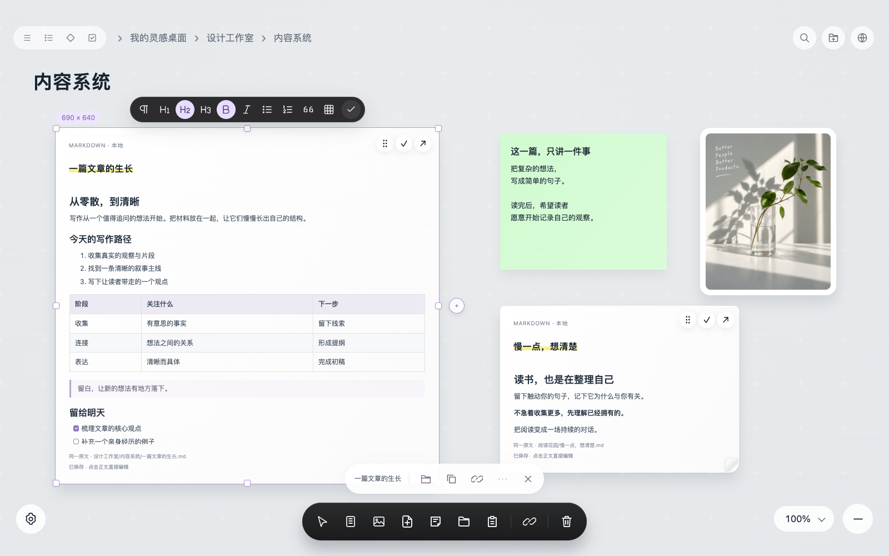

<div align="center">

# Visual Board

**让本地知识，也有设计感。**

把文章、灵感和资料，摆成一张看得懂、愿意打开的桌面。

**本地 Markdown · 嵌套画板 · 就地编辑**

by **Chanson** · Desktop · 简体中文 / English

[下载安装](https://github.com/chansonkang/obsidian-visual-board/releases) · [看看效果](#看看实际界面) · [开始使用](#三步开始) · [更新记录](docs/CHANGELOG.md)

</div>


<p align="center"><sub>AI 创作的产品概念视觉，用于展示设计方向；下面为实际插件界面。</sub></p>

## 文件夹负责收纳，画板帮助理解

文件夹很适合保存文章。可当同一个项目横跨笔记、参考图、PDF 和音频时，目录树难以同时呈现它们之间的关系；来回打开长文，也容易打断正在整理的思路。

Visual Board 为 Obsidian 增加一张可编排的桌面：把相关内容放在一起，用位置、留白和连线表达关系，再把下一层内容收进 Board。阅读、修改、整理，可以留在同一个视野里。文章继续以本地 Markdown 保存，已有的链接和文件夹仍由 Obsidian 管理。

## 不只是把文件变成方块

**整理知识，也可以是一件有美感的事。**

玻璃质感的文件夹，让不同主题有自己的颜色和识别符号；纸张式文章卡片，保留正文的阅读层次；浅灰十字网格，让位置、边界与间距有秩序。胶囊工具栏把常用操作收在手边，图标悬停显示说明，界面为内容留出空间。

它的设计感来自可用的细节：组件靠近时吸附对齐，多张卡片可以等距排列，长文在卡片内独立滚动，选中操作收进紧凑工具条。你可以精细排版，也可以先把想法放下来，再慢慢整理。

## 看看实际界面



<p align="center"><sub>实际运行界面，使用公开演示内容，不包含个人知识库资料。</sub></p>

**把层级变成可以进入的空间。** Board 映射本地文件夹，进入下一层继续整理；顶部路径返回上层。文章、图片、PDF、音频和便签可以放在同一张桌面上，手动关系线和真实文章链接各自保留。



<p align="center"><sub>实际编辑界面；标题、列表和表格保留排版，保存格式仍为 Markdown。</sub></p>

**点击文字，就在当前样子里修改。** 编辑时继续看到标题、粗体、列表、引用和表格，不必切换整篇源码。旁边的图标工具栏提供正文、标题 1/2/3、列表、表格等操作；不会输入 Markdown 符号，也能开始编辑。

## 从“保存了”到“理清了”

| 你想做的事 | Visual Board 的方式 |
| --- | --- |
| 收拢一个项目的材料 | 本地文件夹映射为嵌套 Board，按主题逐层进入 |
| 一边看资料，一边改文章 | 卡片内直接编辑，分别保留各张卡片的阅读位置 |
| 让内容之间的关系可见 | 显示实际双向链接，也可拖出手动连线，调整虚实和粗细 |
| 排出舒服的桌面 | 网格、边界和等间距吸附；多选移动、对齐、等距排列 |
| 收进不同形式的参考 | 导入图片、PDF、音频；图片保持比例缩放，音频本地保存播放进度 |
| 快速复用和调整 | 组件复制粘贴；移动、拉伸、编辑等操作支持相应撤销与重做 |
| 给主题一点个性 | 默认玻璃文件夹搭配颜色与本地 Lucide 图标，或选用 AI 主题图标 |

## 三步开始

当前版本 **0.1.28**，支持 **Obsidian 1.5.0+ 桌面版**。

1. 从 [GitHub Releases](https://github.com/chansonkang/obsidian-visual-board/releases) 下载 `Visual-Board-v版本-Chanson.zip`，解压到知识库的 `.obsidian/plugins/`，得到 `obsidian-visual-board` 文件夹。
2. 在 Obsidian「设置 → 第三方插件」启用 **Visual Board · 可视化桌面**。
3. 点击侧边栏画板图标，或在命令面板运行「打开可视化桌面」。

无需启动网页服务，也不需要安装 Node.js。首次打开会按本地目录呈现内容，之后可以继续编排自己的布局。尚未进入 Obsidian 官方社区目录，目前通过 Release 手动安装，或交给 [BRAT](https://github.com/TfTHacker/obsidian42-brat) 管理：在 BRAT 的 beta 插件入口添加 `chansonkang/obsidian-visual-board`，仓库需已有正式发布附件。

### 把第一张桌面摆起来

- **添加内容**：底部工具栏添加文章、便签、Board 或媒体；也可按住工具图标拖出组件。电脑上的 `.md` / `.markdown` 可拖进画板或目标文件夹。
- **移动与拉伸**：从卡片顶部把手拖动，选中后拖边缘调整尺寸。默认按 20px 网格与附近边界吸附，按住 Alt 自由调整。
- **直接编辑**：点击文章正文修改，停顿后自动保存；点击标题可改名。点击图标工具，或悬停查看说明。
- **进入下一层**：点击 Board 名称或双击入口。把文章拖到映射文件夹，会移动真实文件到对应目录。
- **一起排列**：Shift 点击多选，或 Shift 拖动空白处框选，再对齐或等距排列。点击空白处取消选择。
- **找回和撤销**：Command+Z / Ctrl+Z 撤销，Shift+Command+Z / Ctrl+Shift+Z 重做。删除会移入本地回收站，可从回收站入口恢复。

右上角可搜索标题、正文和 Board 路径，定位文章及匹配内容；地球图标切换中文与英文。想了解各项功能的演变与限制，查看 [完整更新记录](docs/CHANGELOG.md)。

## 更新有入口，排版有归处

0.1.26 起提供更新提示。默认联网时每天检查一次正式 GitHub Release；发现新版后显示提示和设置角标，画板内的更新横幅在编辑结束后显示。也可在画板设置、Obsidian 插件设置或命令面板主动「检查更新」，并关闭自动检查、忽略某个版本。

「下载新版」会打开浏览器下载，不在插件内自动替换或执行代码。手动更新时先退出 Obsidian，只覆盖运行文件，**保留 `data.json`、`draft-recovery.json`、`data.json.previous` 和布局备份，不删除整个插件目录**。重开后可在画板设置确认实际运行版本。还在使用 0.1.25 或更早版本的朋友，需要先手动升级一次，才会获得更新入口；后续下载安装也可由 BRAT 管理。

组件的位置、尺寸、颜色、顺序、连线与音频进度保存到本地。0.1.28 修复旧窗口覆盖新布局、保存期间输入回退和重载后迟到写入的问题。多窗口冲突会保留独立恢复副本，可从画板设置「保存冲突记录」下载；副本位于下述备份目录内的 `conflicts/`，不随滚动备份淘汰。正常重开延续已保存的布局，并提供最近有效快照与 10 份滚动排版备份，默认位于 `.obsidian/visual-board-layout-backups/obsidian-visual-board/`。从备份恢复可能回到较早的成功保存状态；没有备份的旧坐标无法凭空找回。

## 你的文章，继续留在本地

- **本地文件**：Markdown、图片、PDF 和音频保存在知识库。默认文件夹图标离线可用；插件运行界面和依赖随安装包提供。
- **保存与冲突**：文章修改写回真实 `.md`。检测到外部修改时保留草稿并提示处理，不直接覆盖；未提交或冲突草稿另存本地恢复文件。
- **更新检查**：仅请求 GitHub 的公开 Release 元数据和 manifest，不上传笔记、文件名、布局或生图 API Key。无需 GitHub Token，可关闭自动检查；网络失败不影响继续使用本地功能。
- **可选 AI 图标**：只向所配置服务发送 Board 名称与配色来生成图标，文章正文不会发送。服务需要自己的权限与额度，可能产生费用；API Key 仅保留当前画板会话，生成图片保存本地。无需 AI 也能完整使用默认图标模式。[APImart 配置说明](APIMART-SETUP.md)。

## 边界与开发

目前仅支持桌面。编辑覆盖常见 Markdown 标题、列表、引用、表格、代码及部分 Obsidian 扩展，并不等于支持所有第三方语法；Callout 类型和标题暂为只读，正文可编辑。手工连线保存于 Board，实际知识链接仍以文章中的链接为准。几何、移动等撤销主要在当前会话保留；本地回收记录与已保存布局可在重开后读取。更新检查需要可访问 GitHub 的网络，不提供私有仓库检查。

源码包含独立构建所需的界面资源。开发时运行：

```sh
npm ci
npm run build
npm run typecheck
npm test
```

运行文件输出到 `dist/`；浏览器专项检查位于 `tests/`，使用独立演示数据，按需安装 Chrome 与 `playwright-core`。不把模拟提供商测试称为真实付费出图。发布标签与附件流程见 [发布指南](PUBLISHING.md)。第三方许可证随运行包提供。

---

### English

**Visual Board by Chanson** brings a designed visual workspace to local Obsidian notes: translucent folders, paper-like cards, a subtle grid and compact pill toolbars. Organize local files in nested boards, edit rendered Markdown in place, connect ideas, and arrange images, PDFs, audio and sticky notes.

Desktop only, Obsidian 1.5.0+. Install from [GitHub Releases](https://github.com/chansonkang/obsidian-visual-board/releases), or use BRAT with `chansonkang/obsidian-visual-board`. The plugin is not listed in the official community directory. Version 0.1.26 adds optional daily update checks and a manual check entry; downloading opens your browser and does not install code automatically. Keep existing layout and draft files when updating. Notes stay local; optional AI icons send only the board name and palette to your configured provider.
